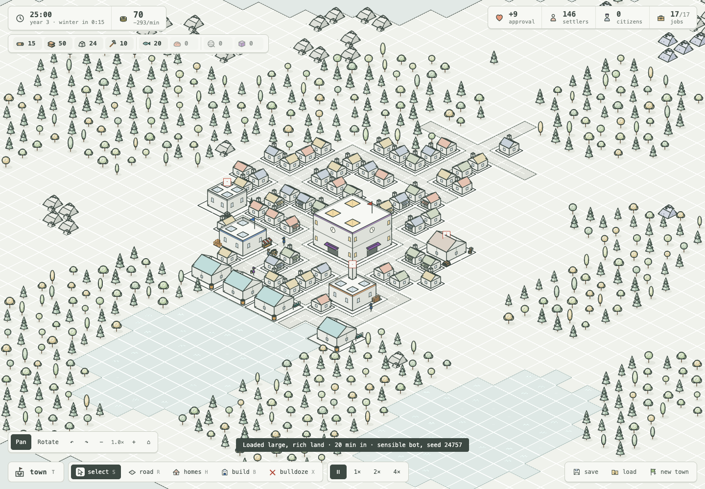

# Developing Inkline Town

[← back to the README](README.md)

Inkline Town is a TypeScript game. The simulation runs on the
[Ritmo](https://github.com/typeonce-dev/ritmo) ECS at a fixed step and
knows nothing of the page; [Three.js](https://threejs.org) draws the 3D world;
Pixi renders the original menu thumbnails; saving is
written with [Effect](https://effect.website).

```sh
pnpm install
pnpm dev --host --port 5232
pnpm typecheck
pnpm test       # model-based tests: random mayors, rules that must always hold; and saving
pnpm check      # lint (oxlint and Ritmo's schedule lints), then every way a term can end, ends it
pnpm check:browser # the actual 3D game: placement, picking, saves, populated towns and phone layout
pnpm check:phone   # phone sizes: the picker's found button on screen, the folded HUD opens and closes
pnpm balance    # a bot plays terms headless and reports the pressure
```

Before pushing, run `pnpm typecheck`, `pnpm test`, and `pnpm check`.

## The playable 3D game

Open [`/`](http://localhost:5232/) with the dev server running. The existing
simulation, town panels, economy, charter, history, reckoning and save format
drive the approved 3D models. Drag to pan; right-drag or choose **Rotate** to
turn and tilt. Scroll to zoom. Q/E turn, arrow keys pan, Home resets, and
the camera toolbar provides the same controls. On touch screens, two fingers
pan and pinch to zoom; twisting them rotates. Road/home tools still drag to
build; camera gestures never place anything. A finger has no hover, so on
touch the tap tools (buildings, park pieces, bulldoze) take two taps: the
first holds the ghost or outline where it landed, a second on the same spot
commits it. The drag tools (road, pave, homes, park ground) hold the stroke
on touch too: **Cancel** and **Build** sit above the tool bar (in the guide's
place) and the tooltip says what it lays and costs; a tap on the stroke's end builds it, a tap elsewhere drops
it, and two fingers move the camera under it. With any pointer, a stroke let
go off the map (over the tool bar, say) is dropped and shows red while it
would be, as are a right click or Esc mid-drag. On touch the tooltip shows
only for what is about to be built, never while panning or picking, in a
thin full-width strip under the top line. This lives entirely in `src/render3d/input.ts`
(and the bar in `host.ts`); the game still sees one ordinary press and
release.

Phones get their layout from `src/phone.css`, loaded after `factory.css`. On
a narrow or short screen the HUD folds away: one top line (clock, treasury,
people, and a chip of planks, stone and tools), one tool bar along the bottom
(town, the tools, pause (a switch: play while paused), a speed button that cycles, and a ⋯ menu holding
share, guide, save, load, new town and recentre), and two buttons top right
for the guide and the map overlays. `host.ts` sets `body.fold-goods`,
`fold-guide`, `fold-views` or `fold-more` while one is open; a tap on the map
folds it, a pan or pinch does not. Once the town has a minute of goods
(`body.flow-ready`), the goods chip opens the made/used table straight away,
each good by its icon. The guide's step stays above the tool bar until tucked away
(its ✕); tucked, the bulb pulses, and a new step (or the same one under way)
comes out again. Guide texts in `src/rules/guide.ts` name tools,
panels and map views as `[homes]`, `[town]` or `[view:fire]` and verbs as
`{tap|click}`, never keys, so they read right on either screen;
`test/guide.test.ts` checks it. Sheets
open from the side on a landscape phone (`max-height: 500px`) and from the
bottom in portrait. Dialogs take the whole screen with their actions pinned
to the bottom. The camera bar is hidden: pinch zooms and turns. New UI needs
nothing there unless it has to move on a phone; check it at 390×844, 360×640
and 762×330, and run `pnpm check:phone`.

`src/render3d/scene.ts` owns the orthographic camera, ground projection and
frame source. `views.ts` follows live construction, upgrades, resources,
production, problem markers and the simulation's walkers and cargo. Flags,
mill sails and smoke animate in 3D. `pool.ts` instances repeated geometry,
preserves entity IDs for picking, varies costumes per instance, and bounds
the cache of unused animation/construction states. Loading or founding a
town clears and rebuilds the presentation from the saved world.

`pnpm check:browser` uses an isolated Chromium browser and the running dev
server (start `pnpm dev` first; without one it times out loading the page). It can use installed Brave/Chrome or `BROWSER_EXECUTABLE_PATH`; otherwise
install Chromium with `pnpm exec playwright install chromium`. `GAME_BASE_URL`
overrides the local URL. It generates a reproducible 20-minute bot save,
loads it through the real UI, and writes screenshots and measurements to
`output/inkline-3d/game-check/`. `GAME_SAVE_PATH` can supply another save.
Phone viewport and simulated touch checks do not replace physical-device testing.



## The art gallery

With `pnpm dev` running, [`/gallery.html`](http://localhost:5232/gallery.html)
shows every drawing in the game side by side: each building with and
without doors, homes, trees, rocks, fields, water, roads, carriers with each
load, walkers, residents, and the page's icons. Scroll or drag to look
around, ctrl + wheel (or pinch) to zoom. `?sheet` lays the same drawings out
as the labelled sheet the README's pictures come from. The gallery is not
part of the build.

## The 3D art study

With `pnpm dev` running, [`/asset-lab.html`](http://localhost:5232/asset-lab.html)
compares the complete world catalogue with the actual drawings from
`art.ts`. Choose a collection or search by name. Drag to rotate; the rotation
and elevation controls also work with a keyboard. The original view uses a
30-degree orthographic camera with the game's 64×32 projection.

| Collection | Entries | Coverage |
| --- | ---: | --- |
| Buildings | 39 | Every building kind, tier 2 market hall and church, plus winter and worn material presets of the seven town services and stores |
| Homes | 21 | Four settler and citizen roof palettes, townhouse, and fine/poor/worn/winter material presets of every tier |
| Land | 32 | Trees, single-cell rocks (full, quarried, and worked down to a face) and larger outcrops, crops, roads, water, raised stone paving, three retained park furnishings and the park layout |
| People | 32 | Carriers, residents, market and chapel walkers, and five equipped service workers |
| Cargo and vehicles | 75 | Twelve distinct goods and labelled crates; empty handcart/barrow and small/full loads of each good; the approved mixed goods plate |
| Construction and effects | 14 | Sites, frame/walls, problem sign, smoke, placement outlines and three kinds of ruin |

The 213 entries cover object families and representative seeded variants.
Continuous growth, construction progress, walk poses and colours can be
generated; this is not a list of every possible random seed. Page icons
remain the game's original 2D UI art.


[`/service-upgrades.html`](http://localhost:5232/service-upgrades.html) compares
the market with the market hall and the chapel with the church. The four
models share one scale and synchronized rotation, tilt and zoom. Each model
has a GLB download. [The asset notes](docs/service-upgrade-assets.md)
describe the asset API and how the town draws them: an upgraded building is
drawn with its tier 2 model, turned a quarter at a time to face its road.

`pnpm assets:build` exports 213 GLBs and editable geometry descriptions,
a manifest, and six standalone viewers to `output/inkline-3d/`:
`inkline-3d-study.html`, `inkline-3d-map.html`, and
`inkline-town-model-review.html`, `inkline-house-effects.html`, `inkline-park.html`, and `inkline-service-upgrades.html`. It reimports every GLB and
checks geometry and unlit materials. The viewers work without a dev server;
their optional web fonts use the network. The game build remains separate.
Material effects render in the viewers and live game. Ordinary GLB viewers
show the underlying mesh; effect parameters are preserved as GLB extras and
in the editable geometry descriptions, rather than baked into duplicate meshes.

- `src/asset-lab/primitives.ts`: renderer-independent polygon/stroke schema
  and reusable modelling operations in the game's cell units and pixel heights.
- `buildings.ts`, `land.ts`, `people.ts`, `construction.ts`: procedural
  models; `assets.ts` collects them and retains the approved house/prop models.
- `renderer.ts`: Three.js adapter, material batching, depth-tested ink,
  continuous curved outlines and silhouette hulls. GLB uses ordinary meshes
  and unlit materials so the ink survives import into another renderer.
- `main.ts`: original drawing comparisons, collection/search UI and downloads.

The art viewer uses fixed poses; the playable game animates them from live
state. The Three.js adapter does not establish compatibility with the private
PixiJS 3D beta. Rear facades and rounded volumes interpret surfaces the original
drawing does not show. GLB edge antialiasing can differ from the live viewer.

### The complete 3D review map

Open [`/map-lab.html`](http://localhost:5232/map-lab.html) to see every catalogue
model on one island. Drag to pan, right-drag or choose Rotate to orbit, and
scroll or pinch to zoom. The toolbar also controls zoom, rotation and tilt.
WASD or arrow keys pan; Q/E rotate; Home restores the original view.
Double-click the ground to focus the camera there.


District shortcuts focus the town, workshops, homes, people, cargo yard or
forest. Inspect selects any of the 203 entries and links to its original
drawing comparison. Eight additional people walk along the street using two
procedural poses; pause them for review. Smoke and the problem sign face
the camera so they stay readable when the map turns.

Map faces and strokes are batched by material. Tests check catalogue
coverage, valid geometry and the presence of every model on the map.
This tests presentation and camera controls; it runs no town simulation.
The walking preview does not export skeletal animation.

## Opening a bot's town in the browser

`pnpm balance -- --snapshot <minute>` writes each seed's town at that minute
to `snapshots/` (git-ignored) as a save file. To play one, put its contents
in the page's save slot from the console and press **load**:

```js
localStorage.setItem("inkline-town/save/manual", /* the file's contents */)
```

`scripts/look-readme.ts` takes the README's pictures and film from such a
save, through the real page with the news, overlays and camera buttons
hidden. It runs on Playwright's clock, so the film steps the town exactly
two thirtieths of a second a frame however slow the screenshot:

```sh
node scripts/balance.ts --size large --land rich --term 90 --seeds 3 --snapshot 80 --out snapshots
SAVE=snapshots/large-rich-1000-80min.json RECKON=1 node scripts/look-readme.ts       # charter, town, street, panels, reckoning
MODE=wide WIDE=0.75 NAME=large SAVE=... node scripts/look-readme.ts                  # one wide view of another town
MODE=film SIZE=1600x900 SCALE=1 SAVE=... node scripts/look-readme.ts                 # 900 frames to output/look-readme/frames
ffmpeg -framerate 30 -i output/look-readme/frames/%04d.png -vf "scale=960:-2,format=yuv420p" \
  -c:v libsvtav1 -preset 4 -crf 46 -g 300 -f avif -loop 0 docs/media/inkline-town.avif
ffmpeg -framerate 30 -i output/look-readme/frames/%04d.png -vf scale=1280:-2 \
  -c:v libx264 -preset veryslow -tune animation -pix_fmt yuv420p -crf 28 -movflags +faststart docs/media/inkline-town.mp4
```

The README shows the film as an animated AVIF, because GitHub plays no
`<video>` from the repository; browsers without AVIF see the still.

## Code

- `src/iso.ts`: the grid and the unit everything is measured in (1/16 cell = 2×1 px).
- `src/content.ts`: goods, building kinds, home tiers, costs, upkeep, taxes: plain data.
- `src/archetypes.ts`: content to components.
- `src/mapgen.ts`: the land of a new town, from its charter.
- `src/schema.ts`: the ECS world: components, relations, resources, services.
- `src/appeal.ts`: desirability: what buildings and the land do to the cells around them, the whole grid, and one cell explained.
- `src/places.ts`: street names for the news ("Mill Lane"), from the nearest landmark.
- `src/grid.ts`: occupancy, entrances, reach, and road paths.
- `src/sim/`: the fixed-step simulation (no renderer access): edits, work (staffing by crew and commute, tools,
  pace), logistics, walkers (services, mending), town (households and tiers), hazards (desirability, risk
  meters, fire and firefighters, sickness, theft), decay (wear, collapse, spoilage, the pantry), and the term
  (seasons and the almanac, the crown, approval, the end of the term, history); orphans drops a walker or field
  whose building went before it could join it.
- `src/present.ts`: per-frame interaction, panel, and view sync.
- `src/art.ts`: all drawing: buildings and their yards, homes, the land, roads, carts, and figures.
- `src/render3d/`: live world renderer, model instances, camera and map input,
  overlays, ruins, surface shaders and roof particle emitters.
- `src/asset-lab/town-props.ts`: parks (ground and furnishings, drawn cell by cell), stone paving and ruins.
- `src/asset-lab/services.ts`: grain hoist, fish racks, watch tower, herbs,
  medical signs, street noticeboard and builder's equipment.
- `src/share/`: sharing a town: the card it is shared as (`card.ts`), the format and limits the page and the
  server agree on (`format.ts`), and the page's side: uploading, fetching, and the device's share sheet (`client.ts`).
- `src/server/`: the only server code: the routes behind shared towns (`handler.ts`), the Cloudflare Worker that
  runs them (`worker.ts`), and the same routes under `pnpm dev`, over a bucket in memory (`dev.ts`).
- `src/asset-lab/appearance.ts`: material state metadata for catalogue presets.
  Wear, neighbourhood, hazards and winter are per-instance attributes in the
  live renderer. A state change does not change the geometry cache key.

### Reviewing the new town models

[`/model-review.html?collection=town`](http://localhost:5232/model-review.html?collection=town)
shows all 23 building kinds plus the market hall and church upgrades. The final
nine refinements are grouped at `?collection=rural`. `src/asset-lab/rural.ts`
owns timber entrances, nursery and farm fittings, chapel porches, granary louvres
and the supported fire-watch access route. The same geometry is used in the game,
catalogue, model sheets and GLB exports.

[`/model-review.html?collection=trades`](http://localhost:5232/model-review.html?collection=trades)
groups the mill, warehouse, fishery, bakery, weaver and watch house revisions.
`src/asset-lab/trades.ts` owns their equipment, loading doors, open yards and the
bakery smoke origin. The mill keeps its animated sails. Cargo sits on the ground
or loading apron, and the four new yard layouts turn towards connected roads.

[`/model-review.html?collection=workshops`](http://localhost:5232/model-review.html?collection=workshops)
groups the revised mine, smithy, sawmill and town hall. The three workshops have
open yards and road-facing layouts. `src/asset-lab/workshops.ts` owns their
geometry, construction frames and smoke origins. The live renderer and catalogue
use the same models; simulation footprints and building costs are unchanged.

Open [`/model-review.html`](http://localhost:5232/model-review.html) for
the models added for PR #3. Collections cover buildings, parks,
home tiers and neighbourhoods, winter, hazards, people/cargo, building
condition, and upgrades & worked faces (the market and chapel beside their
upgrades, and stone and ore full, quarried, and worked down to a face). Drag any model or use the rotation slider to turn the collection.
**Inspect** opens the full asset viewer. **Download GLB** exports one model;
**Save model sheet** captures a labelled sheet of the selected collection.
`pnpm check:models` checks every collection, camera controls, sheet exports
and phone layout, and saves PNGs to `output/inkline-3d/town-review/`.

The **Review fixes** collection groups the revised storage props, entrances,
hay stack, townhouse, quarry, stone deposits, markers and emitters. All building
and house geometry is checked against its plate bounds. Natural rock deposits
use six seeded silhouettes while retaining their simulation cell footprints.
`pnpm check:revisions` renders every catalogue entry, checks the exclamation
mark from both sides and verifies animated smoke through rendered pixels.
The chimney plume uses `render3d/smoke-effects.ts` in both the catalogue and
working buildings. Smoke's GLB stores emitter metadata; particles run at runtime.

Open [`/effects-lab.html`](http://localhost:5232/effects-lab.html) to inspect
eight conditions on the same house geometry. Select any home tier, rotate,
adjust effect strength or pause animation. Dirt, masonry, cracks, snow,
glazing damage and fire light come from `surface-shader.ts`. `structure-effects.ts`
samples the roof triangles for animated fire, smoke and ember emitters.
`pnpm check:effects` captures all tiers, verifies that animation changes the
rendered pixels, checks phone layout and exports a five-second MP4 to
`output/inkline-3d/house-effects/`. The runtime and this preview share the
same instanced renderer and effect code.

The complete proportion comparison is at
[`/proportion-review.html`](http://localhost:5232/proportion-review.html): 36
building appearances and nine shared-prop examples, with the approved
originals beside the revised geometry. Both sides share a camera and an
unchanged walker. Turn, zoom, choose one scale across the catalogue, or save a
comparison PNG. `/model-review.html?collection=handoff` turns the carpenter
and building upgrades, compares scaffolding as materials arrive, and downloads
their GLBs. `?collection=milestones` sets the town hall, guildhall and city
hall side by side; `?collection=works` shows the one reusable construction
scaffold on six building forms, its bays, platforms, ladders and supplies set
by plot size, building height and delivered share.

The original 2D menu drawings remain in `art.ts` for comparison. The live
3D town uses the new geometry, including equipped service workers and cured
fish cargo. The game has no audio, so winter music is outside this model work.

Open `/proportion-review.html?collection=parks` for twelve park before/after
comparisons. The original geometry and walker are frozen in
`public/model-review/parks-before.json.gz` at `f4df9d5`; do not regenerate it
from the revised models. `pnpm check:park-models` checks the paired viewer and
captures front, rear and phone views in `output/inkline-3d/parks/`.
Shared furnishings live in `park-furnishings.ts`, and park ground treatments
in `park-ground.ts`. The bench and planted border also serve civic gardens;
road setts and the park simulation rules are unchanged.

Open `/park-lab.html` for a park assembled from 25 cells using the current
park layout system, with two street entrances. The three retained furnishings
are framed lanterns, tiered fountains and simple stone busts;
`render3d/fountain-effects.ts` supplies moving droplets and impact ripples in
the actual basin. Park rendering in the game, catalogue, map and preview shares
the same emitter metadata and water renderer. `pnpm check:park` verifies the
rendered animation, pause, camera controls and phone layout, and captures stills
and a five-second MP4 in `output/inkline-3d/park-review/`.
- `src/townsfolk.ts`: residents out walking, for looking at only: not simulated, not saved.
- `src/icons.ts`: the page's line-drawn icons.
- `src/gallery.ts`: the dev-only art gallery (see above).
- `src/sim/headless.ts`: a town with no page, stepped from code: what the tests, `check`, and `balance` play.
- `src/save.ts`: saving and loading as [Effect](https://effect.website) programs: a versioned file in a slot
  (the mayor's own, or the autosave), typed errors for each way a load can fail.
- `src/ui.ts`, `src/host.ts`, `src/main.ts`: the page bridge, camera, input, panels, and start-up.

The simulation runs on Ritmo's `FixedLoop` at 60 steps a second (times the
chosen speed), with integer state and a seeded random resource: `Town/Rng`,
declared with `Descriptor.ConstructedResource(Random)` and started with
`Random.seed(...)`. Systems draw with `Random.draw(resources.rng)`, which
writes every draw back (and rolls it back with a failed system). Seeded
streams that are not world state, such as the land in `mapgen.ts` and the
almanac's winters, use `Random.make(seed)`.
Every saved component and resource is validated, so **save** / **load**
snapshot the whole world, history and chronicle included, to localStorage;
the page also autosaves every two minutes of game time, and **load** takes
whichever is newer.

In development the console has `town.ui`, `town.runtime`, and
`town.advance(seconds)` to fast-forward the simulation.

### Simulation rules and lint

`pnpm lint` (part of `pnpm check`) runs oxlint with two plugins: the town's
own (`tools/lint/plugin.mjs`: no `as never` or `as unknown as`) and
[`@typeonce/oxlint-plugin-ritmo`](https://github.com/typeonce-dev/ritmo/tree/main/packages/oxlint-plugin).
In every file, a `runtime.tick(...)` or `runtime.restore(...)` result is
checked (`void` ignores one on purpose), descriptor and system names carry
the `Town/` prefix, and an optional query cell is read with `cell.value()`.

The simulation files, listed in the `overrides` of `.oxlintrc.json`
(`src/sim/`, `src/rules/`, and the pure modules they run: `grid.ts`,
`mapgen.ts`, `places.ts`, `appeal.ts`, `content.ts`, `schema.ts`,
`archetypes.ts`, `iso.ts`), must replay exactly and run headless. They read
time from the `Town/Time` clock and randomness from `Town/Rng` or a seeded
`Random.make`, never `Date.now()` or `Math.random()`; they never touch the
page, host I/O or the renderer; they keep `Infinity` and `NaN` out of data,
which would save but not load; and they do engine-approximated math
(`sin`, `cos`, `atan2`, `exp`, `hypot`, `a ** b`) with `Ops` from
`@typeonce/ritmo-math`, which returns the same bits on every engine.
`Math.sqrt`, `min`, `max`, `floor`, `abs` and `x ** 2` are exact everywhere
and stay. A new module the simulation runs joins that list. `pnpm lint:game`
then checks the schedules themselves with Ritmo's devtools lints.

## Balancing

`pnpm balance` runs a bot that plays the real simulation headless, the way a
kind of mayor would, on several seeds, and reports how each term ended and
how the pressure on the town built up: residents, coins, costs against
income, administration, approval, food, the crown, and which goals were met,
averaged over the seeds still in office every few minutes.

```sh
pnpm balance -- --size large --term 90 --land harsh
pnpm balance -- --bot greedy          # sensible (default), greedy (taxes at 200%, sells everything, ignores the crown), idle,
                                      # crowded (homes packed beside industry, no parks), uncovered (no fire, health, or order services),
                                      # sprawl (taxes as high as the town stands, cottages everywhere, fish caught or bought, no finer homes)
pnpm balance -- --versus crowded      # the bot against another on the same seeds: citizens, burghers, homes lost
pnpm balance -- --versus uncovered
pnpm balance -- --set kinds.sawmill.crew=settlers --set risk.fire.wooden=0   # content changes, numbers or words
CHRONICLE=1 pnpm balance -- --seeds 1                                         # each seed's chronicle too
pnpm balance -- --seeds 4 --from 4    # seeds 4 to 7, to split a sweep across processes
pnpm balance -- --set crown.fine=2 --set kinds.fishery.recipe.seconds=3
pnpm balance -- --seeds 1 --verbose --every 1   # minute by minute
pnpm balance -- --snapshot 40                   # save each seed's town at minute 40 (see above)
```

Each seed reports the ranks it rose to and when, and the summary how many
seeds reached each rank and around which minute. On a medium fair 90-minute
term the sensible bot reaches the village around minute 24 (the citizens'
share holds it back) and the town around minute 36; it builds no parks and
makes no upgrades, so it does not reach the city.

The economy is tuned so that spreading cottages stops paying: food goes by the
resident, administration per home climbs (each more home costs about 6 coins a
minute at 80 homes), taxes above 100% empty homes directly, and bought goods
grow dear fast and calm slowly. On a medium fair 60-minute term (10 seeds for
sensible, 5 for the rest), the sensible bot wins about 7 in 10, crowded wins
rarely, and sprawl and greedy always lose (sprawl to bankruptcy around minute
20, greedy to revolt). Under the old numbers sprawl lasted the whole term with
10,000+ coins.

## Sharing a town

**share** (bottom right, and on the reckoning) draws the town as the camera
sees it into a 1200 × 630 card (at 2×), with the term's state and numbers on a
strip of paper. **Save the picture** downloads it; on a phone it goes to the
share sheet instead. **Make a link** uploads the town (its save file, gzipped,
with the camera) and a JPEG of the card; `/t/<id>` then opens the game on that
town, running, with the building tools put away until the visitor chooses
**Play from here** (the town becomes theirs and autosaves) or founds their own.
A shared town loads through `loadText` in `src/save.ts`, so it is checked and
carried forward between save versions exactly as a save is.

The server (`src/server/handler.ts`) keeps each share as two files in an R2
bucket, `towns/<id>.json.gz` (its preview's title and description as metadata)
and `towns/<id>.picture`:

| route | does |
|---|---|
| `POST /api/towns` | checks the town is gzip under 100 KB, the picture a JPEG/PNG/WebP under 500 KB, and the lines short and plain; keeps them under a new id |
| `GET /api/towns/<id>` and `/picture` | the files as kept, cached for a year (shares never change) |
| `GET /t/<id>` | the game's `index.html` with the share's Open Graph and Twitter tags written in, so links unfurl to the card |

The Worker runs only for `/t/*` and `/api/*`; everything else is a static
file, served free and unmetered. Shares are deleted after 180 days by a
lifecycle rule on the bucket. Uploads are limited per visitor, by a hash of
their IP: 3 a minute through Cloudflare's rate-limit binding (`SHARE_BURST`,
declared in `deploy/alchemy.run.ts`; no resource behind it), and 20 a day
counted in the same bucket under `limits/<day>/<visitor>`, which a second
lifecycle rule clears after a day. Either answers 429 with a line the page
shows. Under `pnpm dev` the same routes run in Vite
over a bucket in memory (shares last until the server stops), so sharing
works locally and `pnpm check:browser` checks it end to end.

## Testing

The simulation has no renderer in it: it runs headless (`src/sim/headless.ts`),
about 60 to 80 times faster than real time, so the tests play real towns.

`pnpm test` also runs `test/legibility.test.ts`: when a home is stuck, the
panel's reasons (`src/rules/explain.ts`) must name the cause in words,
checked against the usual dead ends and a real town with cottages beside a
quarry. The bots know the thresholds; the player only has the panel.

`pnpm test` runs model-based tests built on Effect's `Schema` and
`Arbitrary`. They generate sequences of what a mayor can do (roads, homes,
buildings where they fit, bulldozing, taxes, trade, pausing, answering the
crown, upgrading a building, standing for the next term, saving and
loading, waiting through seasons, and fortune good and bad), play them on
the real simulation, and after every command check what
must always be true: goods within their shelves, tiles on the land and
apart, residents and workers within bounds, the census matching the homes,
walkers belonging to standing buildings, approval and prices within their
bounds, the clock and the record only going forward, rocks never below
their worked faces, a rank never lost, and a term ending only in the
allowed ways (and following only as the next term, when chosen). A failure shrinks to the shortest sequence that still
breaks a rule. A second property checks that the same charter and commands
always make the same town. `RUNS=200 pnpm test` searches harder;
`SEED=…` replays.

`test/endless.test.ts` checks the town that goes on, each in seconds of game
time: each rank asks more than the last, a rock quarried down stays as a
worked face and gives one more now and then (and the bulldozer clears only a
worked face), a market becomes a market hall only once the town is a town
(and pulling one down gives back part of both costs), the next term carries
on the same town with its own winters, and a long reign of five terms ends
each on time, starts the crown's tally afresh each term, thins its older
history, keeps its chronicle capped, and keeps its save in bounds.

`test/share.test.ts` checks the server's routes and what they refuse, and
carries a real town through them into another headless town, which must
then play on step for step the same as the original.

`pnpm check` puts the real simulation into each way a term can end
(bankrupt, revolt, abandoned, dismissed, run out), raises a town through its
ranks and into its next term, checks an unanswered
crown request, and checks that a town saved mid-term loads back the same. It
also checks the neighbourhood: a citizens' home next to a smithy goes back to
settlers; an unwatched row of cottages catches fire and the fire spreads, and
firefighters from a fire watch stop it at one home; fish rots in the town
hall and keeps in a granary; a workplace with no homes within reach stays
unstaffed until a cottage goes up on its road; citizens will not do settlers'
work while settlers stand in for citizens as apprentices; and a home nobody
mends falls down while one by a builder's yard is kept.

## Releasing to Cloudflare

The game is deployed with [Alchemy](https://alchemy.run/) as a Cloudflare
Worker serving the Vite build, with an R2 bucket (`Shares`) for shared
towns. The separate `deploy/` package keeps its dependencies out of the game,
and Cloudflare stores the deployment state. Saves stay in the player's
browser; only towns a player shares go to the bucket. R2 needs a payment
method on the account even within its free tier.

```sh
pnpm install --frozen-lockfile
pnpm --dir deploy install --frozen-lockfile
pnpm --dir deploy exec alchemy plan --stage prod --profile admin --no-input
pnpm release --profile admin --yes --no-input
```

Release from an up-to-date `main`. The release command checks the game's
types and simulation and the deployment config, then Alchemy builds and
deploys the game to <https://inkline.typeonce.dev>. Alchemy attaches that
custom domain to the `prod` Worker and creates its DNS record and certificate
in the `typeonce.dev` Cloudflare zone. Check that the game opens, save/load
works, and a shared link opens and unfurls there after each release.

`admin` is the existing local Alchemy Cloudflare profile. On another
machine, use your own logged-in profile or set `CLOUDFLARE_ACCOUNT_ID` and
`CLOUDFLARE_API_TOKEN`, then omit `--profile admin`. Keep credentials outside
the repository. Releases run locally; pushing to GitHub does not deploy.

For a temporary preview, run:

```sh
pnpm --dir deploy exec alchemy deploy --stage preview --profile admin
pnpm --dir deploy exec alchemy destroy --stage preview --profile admin
```

The second command removes the preview. Each stage has its own Worker;
previews stay on their `workers.dev` URL and never claim the custom domain.

The production build includes the game and all review pages. On any deployed
stage, use `/asset-lab.html` for the complete catalogue, `/model-review.html`
for the PR #3 collections, `/effects-lab.html` for animated house states, and
`/map-lab.html` to inspect all models together in a town.
