# Inkline Town

**A town-builder drawn in ink, played in one sitting.** You are the mayor for
a single term: 45, 60, or 90 minutes. Lay the roads, house the settlers, build
the chains that feed and clothe them, and grow a busy town of citizens before
your time runs out. Or watch it go bankrupt, revolt, or empty out.

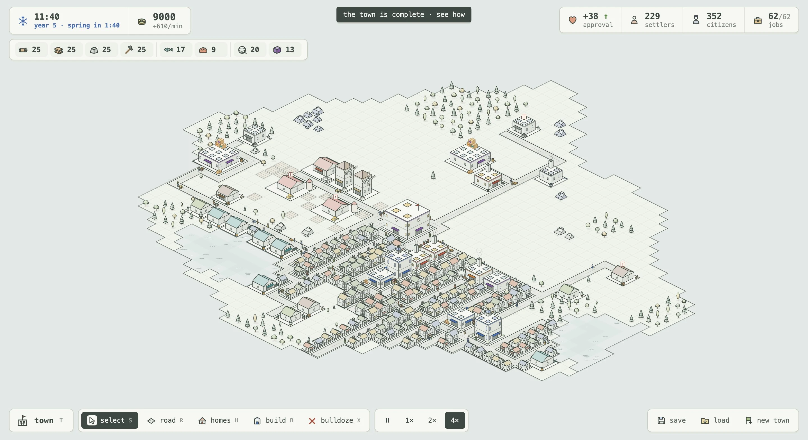

Inkline Town plays like a small Anno in a small box. Every building, cart, and
person is drawn live in thin isometric line art, every map is new, and every
term ends with a verdict and the story of how you got there.

## A new charter, a new land

Each town starts with a charter. You choose the size of the land, how rich it
is in forest, stone, ore, and lakes, and how long your term runs. Every seed
makes a different island, with a wandering coast and capes reaching out.

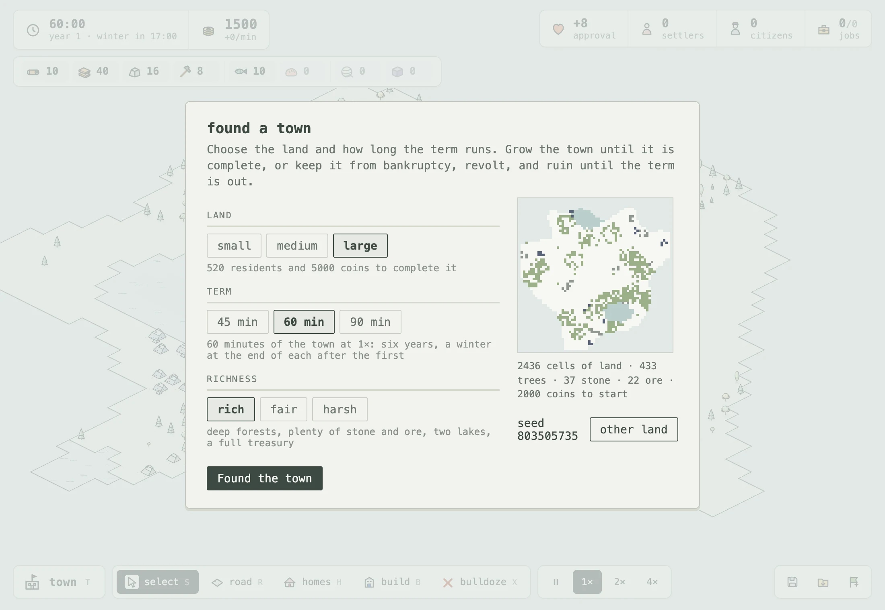

<table>
  <tr>
    <td>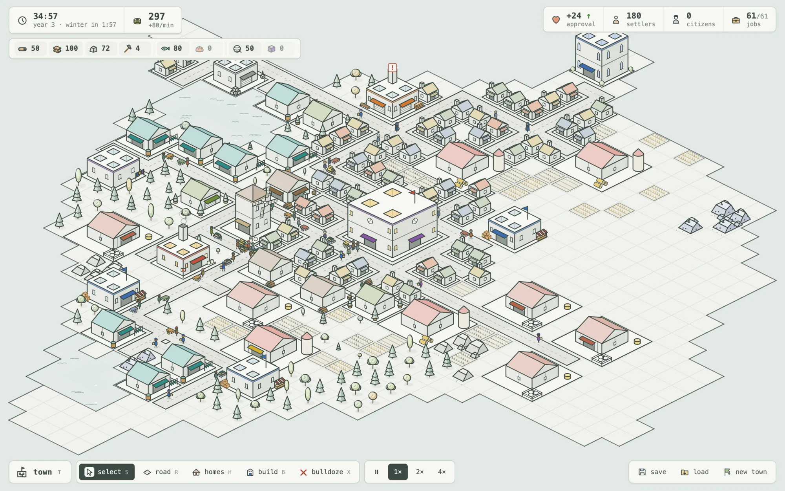</td>
    <td>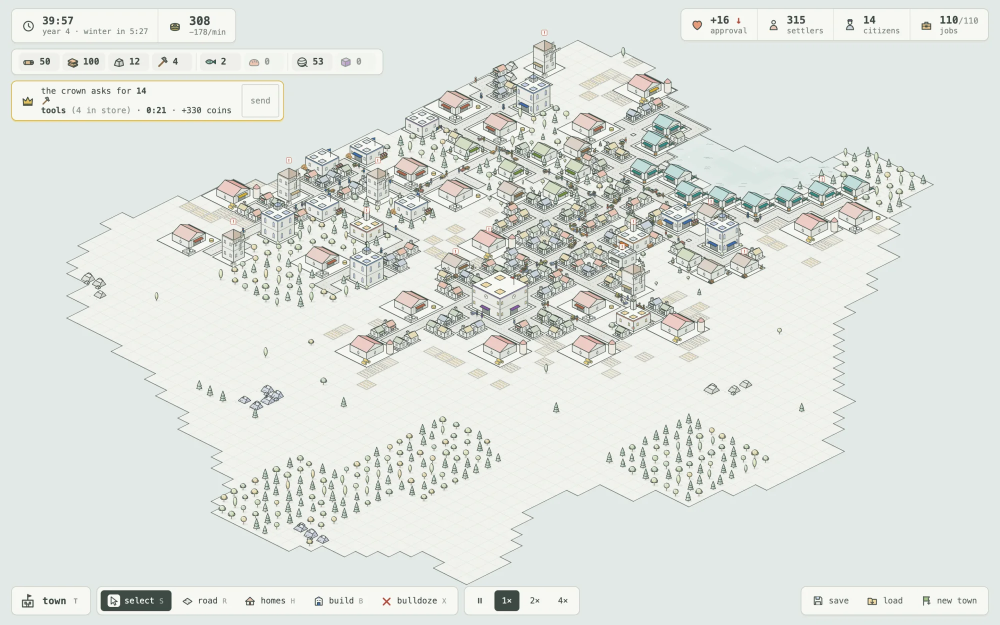</td>
  </tr>
  <tr>
    <td align="center"><sub>small land, rich: farms and mills by year three</sub></td>
    <td align="center"><sub>large land, harsh: thin woods, little stone, and the crown wants tools</sub></td>
  </tr>
</table>

## Build the chains, watch them work

Lumberjacks fell trees and sawmills cut planks. Quarries and mines dig stone
and ore for the smithy's tools. Farms grow wheat for the mill and the
bakery, sheep give wool for the weaver, and fisheries feed the first
settlers. You never move a crate yourself: carriers push their carts along
the roads, each loaded with what it carries, and markets send walkers
through the streets with baskets of fish, bread, and cloth.

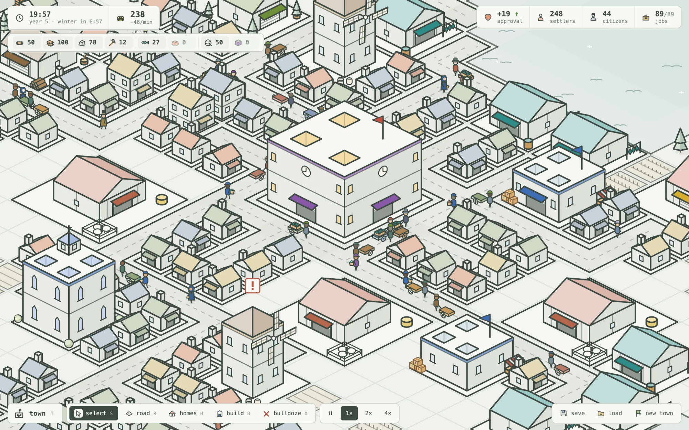

Settlers need food. Give them bread, cloth, and a chapel's faith, and their
cottages grow into two-story citizens' homes that hold and pay twice as
much. Then they come out in long coats and top hats, each household dressed
in the colour of its roof.

## Govern under pressure

The bigger the town, the harder it pulls. Winters stop the fields and thin
the catch. Running the town costs more for every home. Traders pay less the
more you sell. The crown asks for goods on a deadline, and it remembers when
you don't deliver. Approval decides how many people each home holds.

You hold the levers: taxes for settlers and citizens, what to sell or buy and
how much to keep, which buildings to pause, and when to answer the crown.

<table>
  <tr>
    <td>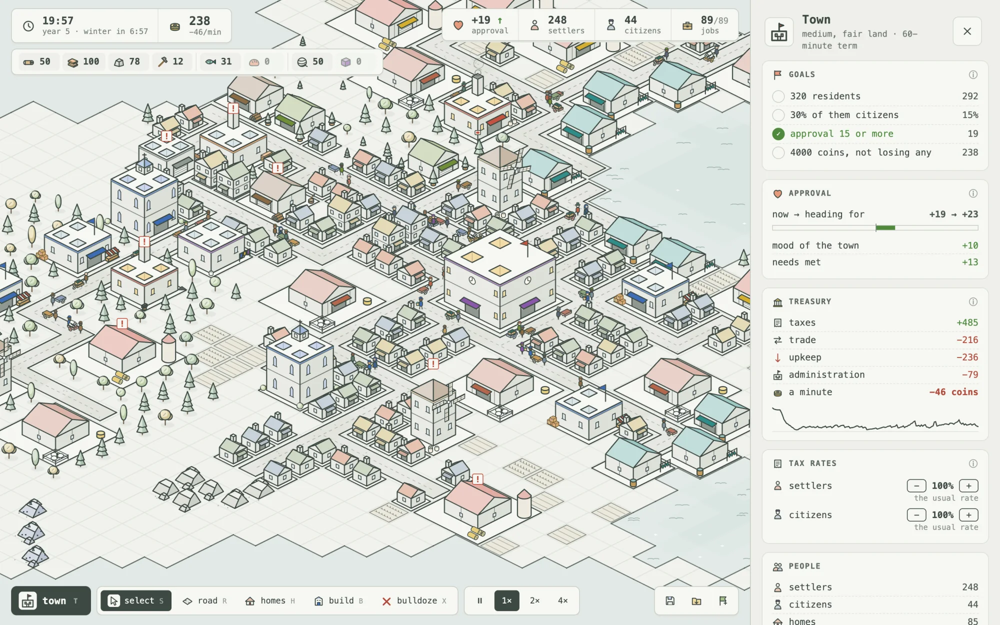</td>
    <td>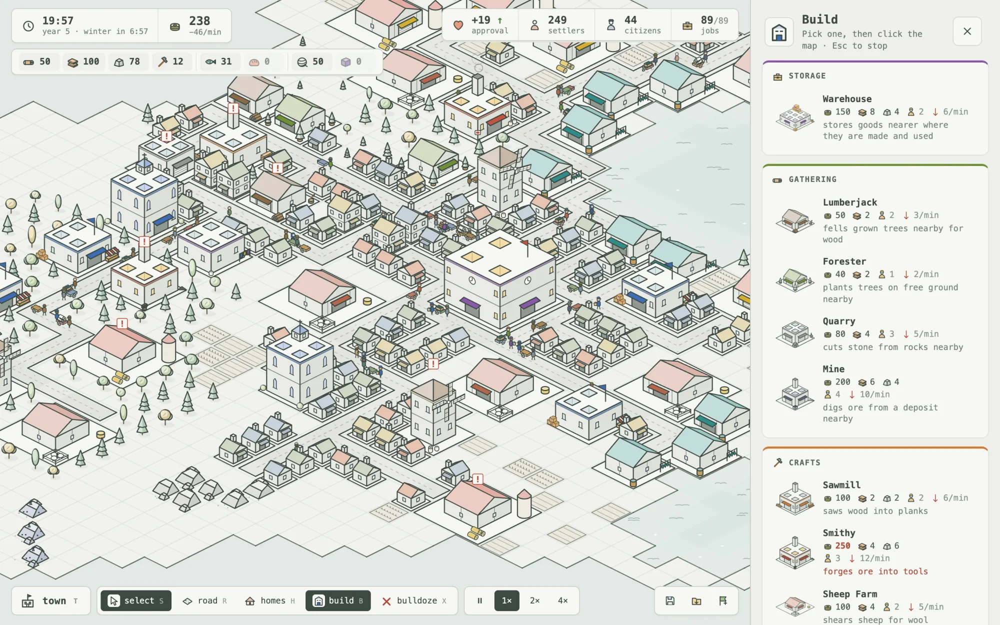</td>
  </tr>
  <tr>
    <td align="center"><sub>the town panel: goals, approval, treasury, taxes, trade</sub></td>
    <td align="center"><sub>the build menu, unlocking as the town grows</sub></td>
  </tr>
</table>

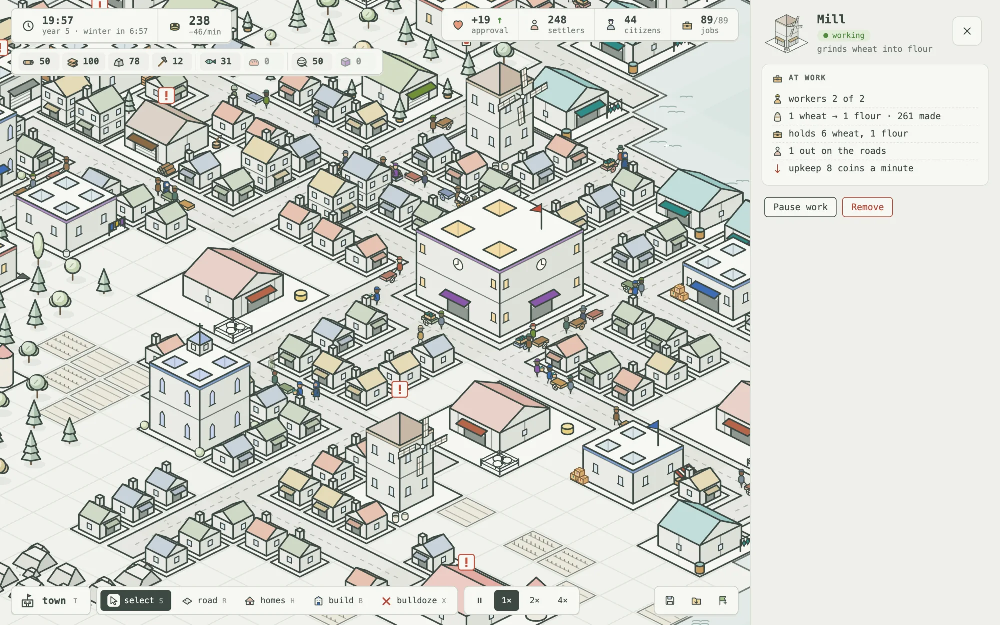

## Every term ends

Hold every goal for two minutes (enough people and coins, three in ten of
them citizens, a town that approves of you) and the town is **complete**.
Retire, or keep governing to the end. Three minutes in debt, two minutes of
uproar, a town that empties out, or three of the crown's requests ignored,
and the term is **lost**. Otherwise time runs out and the town is judged:
flourishing, holding on, or declining.

The reckoning shows how it went: residents, coins, and approval across the
whole term, with the winters shaded, and the chronicle of everything that
happened.

<p align="center">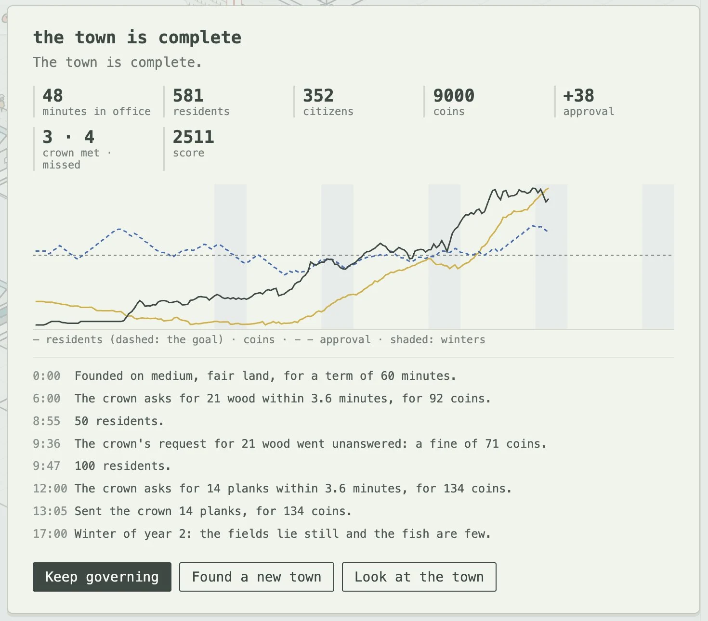</p>

## Drawn in ink

There are no sprites or image files: every picture in the game is drawn in
code with two weights of line on a pale ground. Each building wears the
colour of what it makes and keeps its work in its yard: a log pile, a silo,
a pen of sheep, a striped market stall. Trees, rocks, water, and roads are
different on every cell.

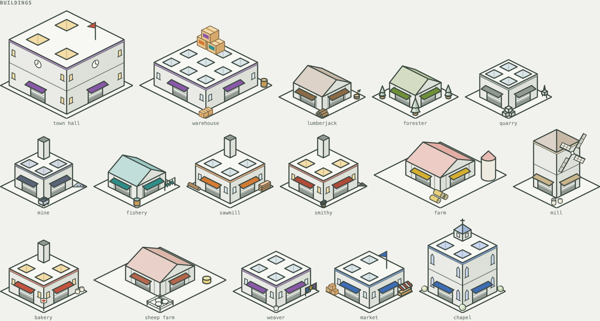

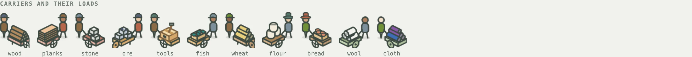


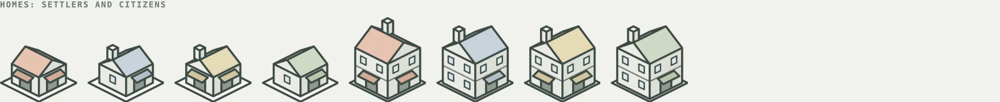

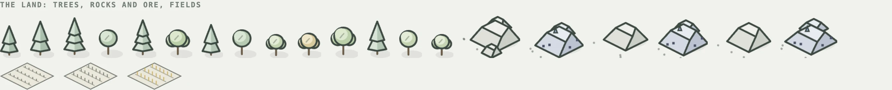

## Play

Inkline Town runs in the browser. Saves stay in your browser, and the town
autosaves every two minutes of play.

```sh
pnpm install
pnpm dev
```

Then open the address it prints. New to the game? [How to play](docs/how-to-play.md)
covers the controls, the rules of a term, and how the town works underneath.

---

[How to play](docs/how-to-play.md) · [Developing](DEVELOPMENT.md) · [The design behind the term](docs/mayor-plan.md)
