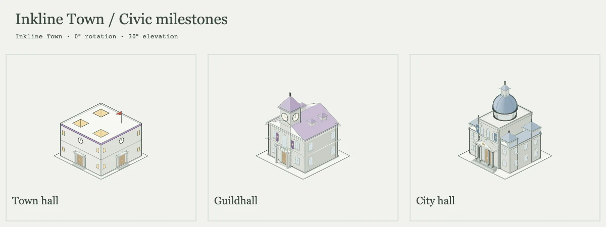
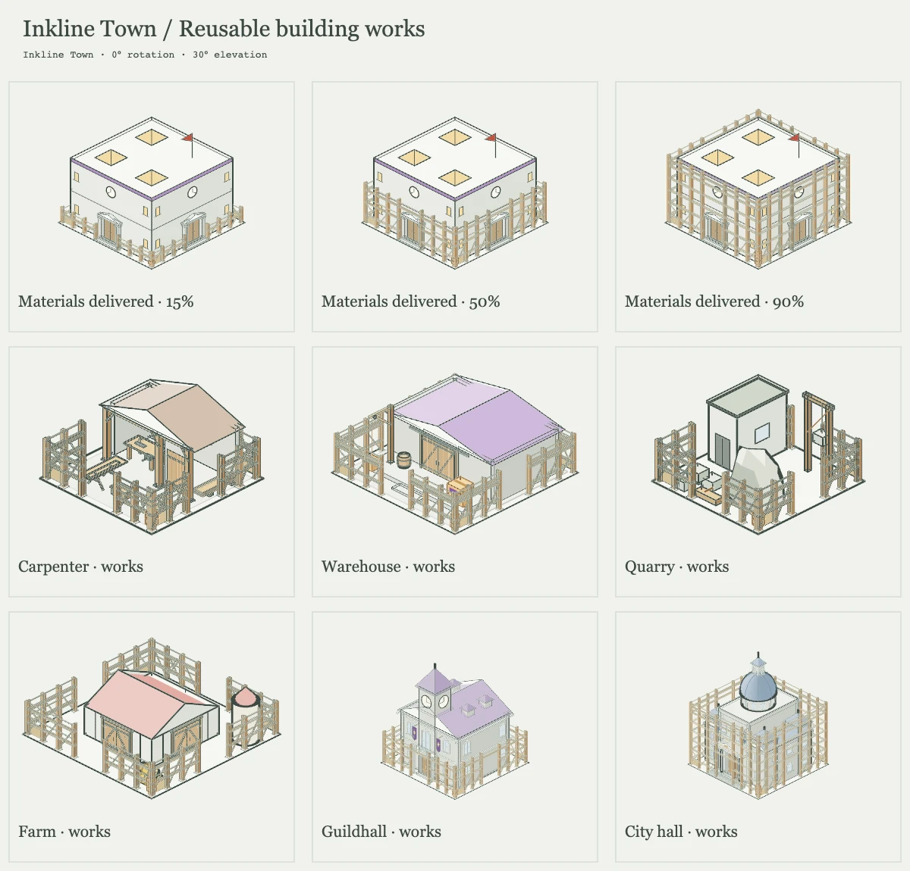
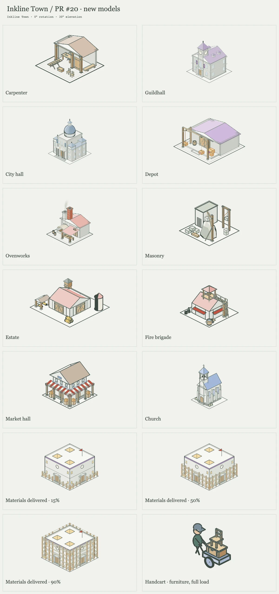

# Inkline Town

**A town-builder drawn in ink, played a term at a time.** You are the mayor
for a term of 45, 60, or 90 minutes, and then another, for as long as the town
stands. Lay the roads, house the settlers, build the chains that feed and
clothe them, and raise a hamlet to a village, a town, and a city of
burghers. Or watch it go bankrupt, revolt, or empty out.


Inkline Town plays like a small Anno in a small box. Every building, cart, and
person is drawn live in thin 3D line art. Pan, zoom and rotate the island;
every map is new, and every
term ends with a verdict and the story of how you got there.

## A new charter, a new land

Each town starts with a charter. You choose the size of the land, how rich it
is in forest, stone, ore, and lakes, and how long your term runs. Every seed
makes a different island, with a wandering coast and capes reaching out.


<table>
  <tr>
    <td></td>
    <td></td>
  </tr>
  <tr>
    <td align="center"><sub>small land, rich: farms and mills by year three</sub></td>
    <td align="center"><sub>large land, harsh: thin woods, little stone, and the crown wants tools</sub></td>
  </tr>
</table>

## Build the chains, watch them work

Lumberjacks fell trees and sawmills cut planks. Quarries and mines dig stone
and ore for the smithy's tools. Farms grow wheat for the mill and the
bakery, sheep give wool for the weaver, a carpenter turns planks into
furniture for the townhouses, and fisheries feed the first
settlers. You never move a crate yourself: carriers push their carts along
the roads, each loaded with what it carries, and markets send walkers
through the streets with baskets of fish, bread, and cloth.


Settlers need food. Give them bread, cloth, and a chapel's faith, and their
cottages grow into two-story citizens' homes that hold and pay twice as
much. Then they come out in long coats and top hats, each household dressed
in the colour of its roof.

## A town that looks and works like a real one

Every street has a desirability. A smithy or a quarry drags it down for
several cells around; parks you lay out yourself (lawns, flower beds,
walks in from the street, lamps, a fountain, a statue), a chapel, and paved streets
lift it. Citizens will only live on a decent street, and the
finest streets, with every service calling and furniture in the parlour,
grow three-storey townhouses.
Settlers do the rough work and citizens the skilled, and nobody walks more
than fifteen road cells to a job, so the far-off mine needs its own
workers' cottages. Zone the town well and it sorts itself into a fine
centre, an industrial edge, and cottages by the mill.

Then keep it standing. A fire watch, a healer, and a watch house send
walkers to keep down the risk of fire, sickness, and theft; a sign goes up
over a home long before disaster, and a fire watch's firefighters race to
any blaze. Fish and bread rot unless a granary keeps them, tools wear out,
and a builder's yard has to mend what runs down. Each year's winter is
mild, normal, or hard, and the almanac tells you which a year ahead. Map
views show desirability, workers, fire, health, order, and condition across
the town.

## Govern under pressure

The bigger the town, the harder it pulls. Winters stop the fields and thin
the catch. Running the town costs more for every home. Traders pay less the
more you sell. The crown asks for goods on a deadline, and it remembers when
you don't deliver. Approval decides how many people each home holds.

You hold the levers: taxes for settlers and citizens, what to sell or buy and
how much to keep, which buildings to pause, and when to answer the crown.

<table>
  <tr>
    <td></td>
    <td></td>
  </tr>
  <tr>
    <td align="center"><sub>the town panel: goals, approval, treasury, taxes, trade</sub></td>
    <td align="center"><sub>the build menu, unlocking as the town grows</sub></td>
  </tr>
</table>


## Every term ends, the town goes on

A town is founded as a hamlet. Hold every goal of the next rank for two
minutes (enough people and coins, a share of them citizens, a town that
approves of you) and it rises to a **village**, then a **town**, then a
**city**, whose finest streets must hold burghers in townhouses. Each rank
brings a reward from the crown and opens upgrades made where buildings
stand: the town hall becomes a guildhall and then a city hall, the market
a market hall, the bakery an ovenworks, the quarry a masonry, and more,
with scaffolding rising while carriers bring their materials. Nothing ends
when a rank is reached.

Three minutes in debt, two minutes of uproar, a town that empties out, or
three of the crown's requests ignored, and the term is **lost**. Otherwise
time runs out and the term is judged: flourishing, holding on, or declining.
Stand for the **next term** to carry on the same town, or retire and found a
new one. The open stone and ore run out, but the worked faces they leave keep
giving a little, so a long reign never runs dry (or clear them to build).

The reckoning shows how the term went: residents, coins, and approval
across it, with the winters shaded, and the chronicle of everything that
happened.

<p align="center"></p>

## Drawn in ink

There are no sprites or image files: every picture in the game is drawn in
code with two weights of line on a pale ground. Each building wears the
colour of what it makes and keeps its work in its yard: a log pile, a silo,
a pen of sheep, a striped market stall. Trees, rocks, water, and roads are
different on every cell.


The carpenter and building upgrades can be inspected in the model review.
The complete proportion comparison is at `/proportion-review.html`: 36 building
appearances and nine shared-prop examples, with the approved originals beside
the revised geometry. Both sides share a camera and an unchanged walker.
Turn, zoom, choose one scale across the catalogue, or save a comparison PNG.
Run `pnpm dev`, then open `/model-review.html?collection=handoff` to turn the models, compare
scaffolding as materials arrive, and download their GLBs.

The civic milestones have their own comparison at
`/model-review.html?collection=milestones`. The guildhall's clock tower,
steep roof and guild banners give way to the city hall's domed centre,
lower wings and columned entrance.



`/model-review.html?collection=works` shows one reusable construction
scaffold on six building forms. Plot size, building height and delivered
share determine its bays, platforms, ladders and supplies.






## Play

Inkline Town runs in the browser. Saves stay in your browser, and the town
autosaves every two minutes of play. Share a picture of your town, or a link
that opens it running for anyone, who can then play on from where you left it.

```sh
pnpm install
pnpm dev
```

Then open the address it prints. New to the game? [How to play](docs/how-to-play.md)
covers the controls, the rules of a term, and how the town works underneath.

---

[How to play](docs/how-to-play.md) · [Developing](DEVELOPMENT.md) · [The design behind the term](docs/mayor-plan.md)
