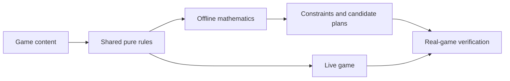

# Offline balance model

The model reads the game's content and pure rules. It runs independently of the ECS and renderer. The game never imports `tools/balance/`. The verification layer deliberately starts the real headless game to check selected predictions.

No values in `src/content.ts` changed when this component was added. Private carrier/walker constants moved into shared configuration with their original values. `src/rules/` owns immutable inputs and the existing household, tax, trade, approval, production cadence, staffing, season, risk, road-choice and dispatch-priority functions. The simulation calls the same functions. Grid and desirability calculations retain their existing shared implementations.

## Run it

```sh
pnpm balance:model analyze --scenario zoned
pnpm balance:model analyze --snapshot snapshots/medium-fair-1000-30min.json
pnpm balance:model analyze --scenario zoned --winter hard --minutes 4.5
pnpm balance:model project --scenario bootstrap --seconds 600
pnpm balance:model search --homes 8
pnpm balance:model verify --seeds 32
pnpm balance:model report --seeds 32
pnpm balance:model:check
```

`report` writes `results.json`, `results.md` and a standalone `results.html` to `output/balance-model/`. `--out` chooses another directory. JSON preserves detailed capacities, household constraints, service probabilities, calibration errors and provenance. Reports always use the shipped parameters.

To reproduce the original bot-town analysis, first capture the PR's default sensible mayor:

```sh
pnpm balance --seeds 1 --term 60 --snapshot 30
pnpm balance:model report --snapshot snapshots/medium-fair-1000-30min.json --seeds 32
```

The original bot is used as an existing consumer for diagnosis and behavior-preservation evidence. It is not the mathematical solver.

## API and ownership

```ts
import { resolveRules } from "./src/rules/config.ts"
import { analyze, project, fromSnapshot, assessTransfers } from "./tools/balance/index.ts"

const rules = resolveRules()
const scenario = fromSnapshot(save.world, "my-town", rules)
const inputs = { rules, scenario }

const budgets = analyze(inputs, { minutes: 10 })
const forecast = project(inputs, { seconds: 600 })
const transport = assessTransfers(inputs, [
  { source: warehouseId, target: millId, good: "wheat", goodsPerMinute: 7.5 },
  { source: warehouseId, target: bakeryId, good: "tools", goodsPerMinute: 0.125 },
])
```

`Scenario` contains plain buildings, households, roads, land, reserves, policy and optional trade conditions. Counts and locations are scenario choices. Rule values come from `resolveRules()`; there is no second recipe table in the analyzer. Construction schedules use the same scenario and ordinary player edits in `verifyBuilds`.

Parks are individual ground cells with optional furnishings. Their grouping, repeat penalties, entrance bonuses, reach, desirability and upkeep come from the same functions as the game. Construction schedules can place ground and furnishings as well as ordinary buildings. Furnishings are scheduled after the ground's entities exist.



`src/rules/` contains game behavior. `tools/balance/model/` contains mathematical transformations and approximations. `tools/balance/verify/` owns runtime adapters and controlled experiments. `catalog.ts` contains authored examples, not universal winning layouts.

## What is calculated

- Staffing uses the real commute graph, scarcity-first assignment, insertion-order tie breaks and apprenticeship pass.
- Workshop throughput integrates the actual periodic tick cadence. Apprentice and equipment factors can overlap, so multiplying average factors is insufficient.
- Resource flow is a pooled steady-state relaxation constrained by upstream recipes and accessible sources. Initial perishable stock supplies an instantaneous expected spoilage estimate. Food feasibility uses capacity before spoilage, so a large reserve does not create a false impossibility claim.
- Carrier budgets use real road distances, speed, load size and pools shared across goods. Specified transfers expose a necessary workload constraint. The live dispatch policy still has queues and finite inventory effects.
- Service analysis enumerates finite non-backtracking random-walk paths by dynamic programming. Path hitting probabilities are exact for uniform choices on fixed roads. Mean occupancy, independent-excursion gap estimates and unlimited goods baskets are explicit approximations.
- Desirability, tier eligibility, tax rounding, price changes, refunds, approval and seasonal timing use shared game functions.
- Local disaster deadlines use shared integer risk increments. Their inputs are held fixed; contagion and changing neighbourhoods require verification. Maintenance reports material demand and the repair-to-half-speed window.
- Progression evolves finite reserves, recipe rates, crop maturation, purchases, construction and household tiers in coarse time steps. It exposes construction conflicts, including farms planting over future workshop plots.

The prediction runner does not recreate 60 Hz entity execution. Its regular mean visits, pooled shelves/tools, construction completion and crop placement are approximations. It does not claim an exact joint distribution of fires, sickness, repairs or victories. Wild forest growth has a conservative maximum-rate allowance in static analysis; transient tree forecasts count only the supplied finite trees.

## Counterfactuals and tuning

`search` enumerates production packages and reports cost, material/tool capital, staffing and output constraints with unchanged rules. Its fixed geometry can make a large package unstaffable even if enough residents exist globally.

The optional immutable experiment API and CLI never write tuning changes to content:

```sh
pnpm balance:model sweep --path kinds.weaver.recipe.seconds --values 4,8,12
```

`searchParameters(inputs, candidates, score)` evaluates explicit candidate rule sets. Supply a score reflecting the desired resource or constraints. These are hypothetical results; they require runtime verification before adoption. The committed results use no such patches.

## Verification and interpreting results

`balance:model:check` checks module boundaries, immutable candidate inputs, staffing, inaccessible workplaces, resource conservation, desirability, carrier-pool accounting, configuration search and controlled real-game comparisons. Candidate weaver periods and park beauty/upkeep values are also executed by the game to verify that both consumers receive the same inputs.

The construction case starts on authored flat land with roads and homes charged against fair starting funds, then builds through ordinary edits. It demonstrates a reachable citizen district in that stated starting configuration. It does not establish victory from every generated charter.

Production comparisons allow one incomplete job; transport allows one in-flight load per carrier at the observation boundary. Service comparisons use independent fixed seeds and report their sample sizes and statistical tolerances. The coarse forecast's timing and cash errors remain visible. Passing the controlled checks does not turn an approximate forecast into an exact outcome prediction.

The original seed-1000 sensible mayor's entire minute-30 world is checked against PR #3 commit `9b7ce7336a18f917a10aa6e21ae32cb57af88643`, with reference SHA-256 `3eff85260d3a97c25ad628dcf244e8f8b4abc6cd02407eed4446807e03d97557`. This checks the shared-rule extraction across production, transport, random streams, risks, economy and persistence. The bot has no parks by minute 30; a separate real-game park comparison covers that rule family. Refresh the reference only after an intentional gameplay or engine change has been reviewed.

Every report includes rule, content, source and scenario fingerprints. A rule change recomputes the analysis; a semantic change in the game must either update a shared function or fail the behavior/verification checks. Mathematical approximations also need calibration when their assumptions change.

See [the measured results](balance-model-results.md) for findings and their practical limits.
